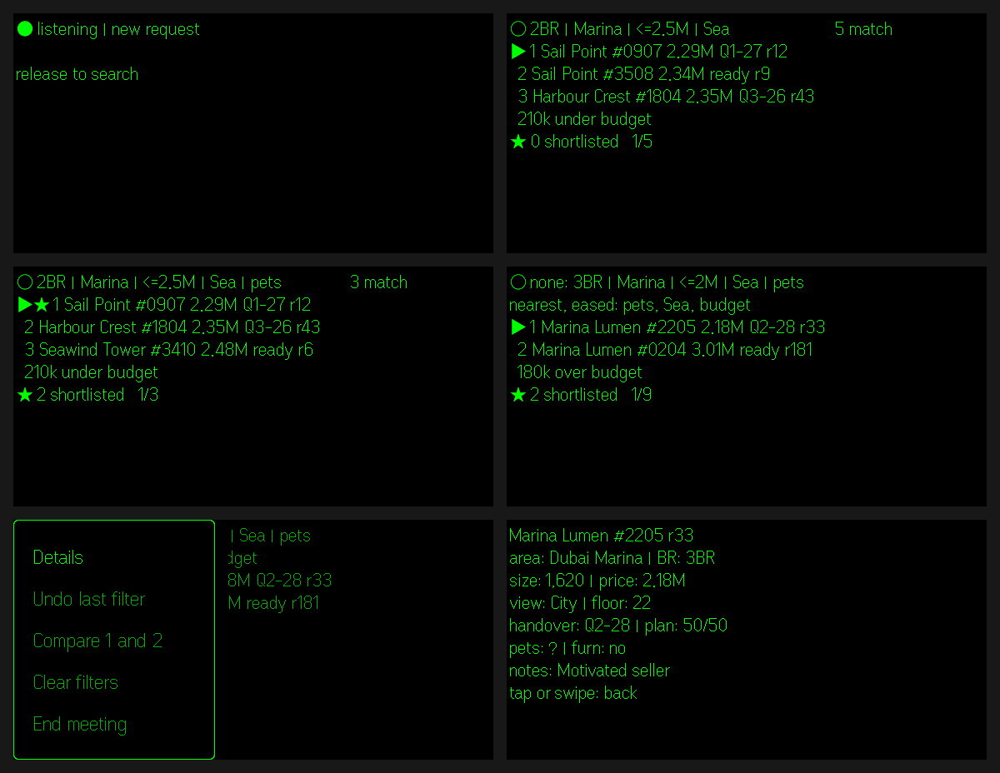

# Onhand

Onhand puts your Google Sheet on Even Realities G2 glasses during a client meeting. Hold the ring and repeat what the client asked for ("two bed in Marina, under two and a half, sea view"). The lens shows the three closest rows with their sheet row numbers. Tap to shortlist a row and swipe to move through the list. When nothing matches, Onhand says so and shows the nearest rows, with what it had to loosen to find them. When the meeting ends, the shortlist goes into a Leads tab in the same sheet and a follow-up email waits in Gmail drafts.

Built for the Even Realities G2 "Heads Up" hackathon, track AI Assistants & Work.



*Captured from the Even Hub simulator 0.9.5 during a scripted meeting. Left to right, top to bottom: listening, first results, after "it has to allow pets" with two rows shortlisted, a request with no exact match, the ring menu, row details.*

## The problem

A property agent in Dubai keeps their stock in a sheet: a few hundred units, each with area, bedrooms, price, handover date, view, pets and furnishing. When a client changes their mind mid-meeting ("actually, it has to allow pets"), the agent has to look down at a laptop, rewrite the filters and scroll, and the conversation stops. The same thing happens to a waiter checking allergens and to a car dealer checking stock.

The bundled demo sheet has 250 usable units out of 258 rows. That includes 4 rows with prices the loader can't read and 4 duplicate listings, which is how real stock sheets look. A meeting usually needs 3 to 6 changes of filter in a few minutes.

## What the lens shows

The same three requests as text, straight from the engine on the demo sheet:

```
>> Two-bed in Marina, under two and a half, sea view
○ 2BR | Marina | <=2.5M | Sea                         5 match
▶ 1 Sail Point #0907 2.29M Q1-27 r12
  2 Sail Point #3508 2.34M ready r9
  3 Harbour Crest #1804 2.35M Q3-26 r43
  210k under budget
★ 0 shortlisted   1/5

>> Actually, it has to allow pets
○ 2BR | Marina | <=2.5M | Sea | pets                3 match
▶ 1 Sail Point #0907 2.29M Q1-27 r12
  2 Harbour Crest #1804 2.35M Q3-26 r43
  3 Seawind Tower #3410 2.48M ready r6
  210k under budget
★ 0 shortlisted   1/3

>> What about three bed under two?
○ none: 3BR | Marina | <=2M | Sea | pets
nearest, eased: pets, Sea, budget
▶ 1 Marina Lumen #2205 2.18M Q2-28 r33
  2 Marina Lumen #0204 3.01M ready r181
  180k over budget
★ 0 shortlisted   1/9
```

`r12` is the row number in the sheet, so the agent can point the client at the exact line afterwards. Every screen fits the G2 lens: 8 lines at most, an estimated 560 px per line, and only glyphs the G2 font draws.

## How it works

1. **Ring.** Hold to listen, release to run. Tap shortlists the highlighted row, swipe moves the highlight, and a contextual menu has Details, Undo last filter, Compare 1 and 2, Clear filters and End meeting. Double tap is left to the system exit dialog.
2. **Speech.** While the ring is held, the app streams 16 kHz PCM from the G2 microphone to the server. The server relays it to Deepgram (nova-3) and sends the area and project names from the sheet as key terms, so names like "Jumeirah Village Circle" come back spelled right. Words appear on the lens while you speak.
3. **Parser.** Plain TypeScript turns the words into filters, using only the sheet's columns and the values that exist in it. It handles spoken numbers ("two and a half million", "1.8M max", "between 1.2 and 1.8"), negation ("anything but Marina", "she can't have sesame"), corrections ("forget the view", "budget doesn't matter"), sorting, comparing rows and counting.
4. **Claude fallback.** Claude is asked only when the parser leaves words it could not use, and only about those words. It returns a structured filter object. Every filter is checked against the sheet before use, and a made-up column or value is dropped. If the sheet cannot answer, the lens gets a short note such as "no JBR in this sheet".
5. **Engine.** Plain code filters the rows. A blank cell never counts as a no: those rows come after the sure matches, marked `?`. When nothing matches, the engine loosens filters one at a time in the order the sheet defines (pets, furnished, view, price, handover, area, bedrooms). For price it switches to the rows closest to the budget. It never loosens an allergen or an exclusion.

6. **Book by voice.** "Book a viewing for number 1 on Saturday at 11" shows a confirm screen with the row and the time. A tap creates a 30 minute Google Calendar event with the unit's details, and the follow-up email says which option is booked. Swipe or hold cancels. The day and time parser handles "tomorrow at 5", "next Monday morning" and "on the 3rd at 4:30 pm" (`shared/test/when.test.ts`).
7. **Sheet.** A short Apps Script in the sheet (`apps-script/Code.gs`) serves each tab as displayed values, so prices like "AED 2.35m" and "2,350,000" arrive the way the agent typed them and go through the same loader. End meeting appends one row to a Leads tab (date, filters, shortlisted rows, what the client said, draft link) and creates a Gmail draft that lists each option with its sheet row number. The script answers only calls that carry a token, and only the server knows the token.

Claude never sees or filters the rows. A wrong answer from the model can at most add a filter on a real column, and that filter shows on the first line of the lens.

The same parser and engine run three sheets with hand-written column lists in `shared/src/schemas.ts`: Dubai units, a restaurant menu with allergens, and used-car stock. Any other tab works too: `shared/src/infer.ts` reads the header and values and decides each column's type (money, count, number, yes/no, category, list, date or text), the words a person would say for it (from the header), the units ("cm", "km"), and which column names the row. A furniture showroom and a recruiter's candidate list, neither seen before, answer requests like "a grey sofa under 4000 that is in stock" and "backend engineer who knows Kafka, under 30 lakh, remote" with the right rows (`shared/test/infer.test.ts`).

## Results

All numbers come from scripts in this repo.

| Check | Result | Command |
|---|---|---|
| Unit and property tests | 250 passed | `npm test` |
| Parser, 80 meeting requests across 3 sheets, each expected answer reviewed by hand | 80 of 80 | `npm test` (shared/test/parse-eval.test.ts) |
| Parser, 20 requests written after tuning | 15 of 20 on first run, 20 of 20 after fixing the 5 misses | `npm run eval:parser` |
| Engine properties, 1,000 random queries | every sure row passes every filter, every maybe row fails none | `npm test` (engine.test.ts) |
| Simulator input check: hold, release, swipes, taps, tap then hold, menu | 10 of 10 reach the app | `npm run check:sim` |
| Speech, 3 spoken clips through the relay | final text 0.40 to 0.45 s after release, all three transcribed correctly | `npm run check:speech` |
| Claude fallback on 2 requests the sheet cannot answer | correct notes in 1.7 to 3.9 s | server log |
| Sheet bridge against a stand-in script: read tab, lead row, draft text, wrong token | 4 of 4 | `npm test` (server/test/live.test.ts) |
| Real Google Sheet: 250 units read, 2 requests, 2 rows shortlisted, End meeting | Leads row 2 written with rows r12 and r43, Gmail draft created, about 15 s with a cold Apps Script | manual run, Nov 26 |

The held-out set is no longer unseen after those fixes, so the 15 of 20 is the honest number for new phrasing.

## What broke and how it was fixed

- **"2.5 million" read as 2.5 m plus "illion".** The money pattern tried `m` before `million`. Longer scale words now come first, and a word boundary is required.
- **A three bed under two million in Marina does not exist.** Loosening one filter at a time gave poor nearest rows. The engine now loosens filters cumulatively in a fixed order, so the lens can say exactly what it eased.
- **Tap then hold.** A hold that starts right after a tap can be the system's own gesture. The app drops a hold within 600 ms of a tap, and its release too.
- **Simulator console reads.** `since_id` on the simulator's console API is exclusive. The input check skipped events until the cursor was set to the last id seen.

## Run it

Requirements: Node 20 or newer.

```bash
npm install
npm run demo
```

That starts the app and opens the Even Hub simulator on a scripted client, with no keys and no server. Long press the ring in the simulator to hear the next client line and release to run it. Swipe to move, tap to shortlist, and open the ring menu for details, undo, compare and end. `npm run demo -- menu` and `npm run demo -- cars` run the other two sheets.

To drive it yourself, run `npm run dev` and `npm run sim` in two terminals. The app runs with no keys and no server. Type a request into the companion page and hold the ring (or Space in the browser), or open `http://localhost:5173/?replay=hero` so each hold plays the next line of a scripted client. There are also `?replay=menu` and `?replay=cars`.

For live speech and the Claude fallback:

```bash
cp server/.env.example server/.env   # add DEEPGRAM_API_KEY and ANTHROPIC_API_KEY
npm run server                       # http://localhost:8787
```

The app finds the server on load and shows `speech on, fallback on` in its event log. Set `VITE_ONHAND_SERVER` to point it somewhere else.

To use your own Google Sheet:

1. Create a Google Sheet and import `shared/fixtures/dubai_units.csv` (or your own stock with similar headers) into a tab named `Units`.
2. Open Extensions, Apps Script, and paste `apps-script/Code.gs`.
3. Run `setup` once from the editor and approve the Sheets and Gmail permissions. It creates the token and prints it in the execution log. (For a standalone script project, first add the script property `SHEET_ID` with the sheet's id.)
4. Deploy as a web app: execute as me, access anyone.
5. Put the web app URL in `SHEET_SCRIPT_URL` and the printed token in `SHEET_SCRIPT_TOKEN` in `server/.env`, then restart the server.

The app then lists every tab, for example `Agency stock: Units, 250 rows`. Tabs named `Units`, `Menu` and `Cars` use the hand-written schemas (`SHEET_TABS` changes the mapping). Every other tab except `Leads` gets a schema worked out from its columns.

Tests and checks:

```bash
npm test
npm run typecheck
npm run eval:parser
npm run sim:replay     # simulator on the scripted client, then in a second terminal:
npm run check:sim
npm run check:speech -- dubai-units clip.wav   # 16 kHz mono 16-bit WAV
```

## Deploy

- **Server:** `render.yaml` is a Render blueprint for the free plan. Create a Blueprint from this repo and set `DEEPGRAM_API_KEY`, `ANTHROPIC_API_KEY`, `SHEET_SCRIPT_URL` and `SHEET_SCRIPT_TOKEN` in the dashboard. The free plan sleeps after 15 minutes idle and takes about 50 s to wake, so open `/health` before a meeting.
- **App:** `npm run pack -w app` builds `app/out.ehpk` (about 67 KB) for Even Hub. The production build talks to `https://onhand-g2.onrender.com`, set in `app/.env.production`, and `app/app.json` whitelists that origin for HTTPS and WebSocket.

## Layout

| Path | What is there |
|---|---|
| `shared/` | Normalizers, CSV loader, sheet schemas, parser, engine, lens screens, fixtures and tests. Runs in the app and the server. |
| `app/` | The Even Hub app: ring input, session state, mic streaming, companion page. |
| `server/` | Hono server: Deepgram relay at `/listen`, Claude fallback at `/fallback`, live sheet at `/sheet/:id`, end of meeting at `/export`. Keys stay here. |
| `apps-script/` | The Apps Script that sits in the Google Sheet. |
| `scripts/` | Simulator input check and speech check. |

## What existed before Nov 23

- The first commit is the Even Hub `asr` template from even-realities/evenhub-templates, unmodified. Everything after it was written during the hackathon, from Nov 23.
- Libraries and services used as they are: Even Hub SDK, CLI and simulator, Vite, Hono, `ws`, the Anthropic TypeScript SDK, Zod, dotenv, Vitest, fast-check, tsx, Deepgram's streaming API and Google Apps Script.
- No Onhand code, data or prompts existed before the build week. The demo sheets are generated by a script in this repo.

## Data and caveats

- All three sheets are synthetic, made by `shared/scripts/gen-fixtures.ts` from a fixed seed. Project names, unit numbers and prices are invented.
- Tested in the Even Hub simulator 0.9.5 with a PC microphone. It has not run on G2 hardware yet.
- The Gmail draft has no recipient. The agent adds the client's address before sending, and Onhand never sends email.
- Speech needs a network connection. Without one, typed requests and replay still work.

## Built with

Even Hub SDK 0.0.16 and simulator 0.9.5, TypeScript, Vite, Hono, Deepgram nova-3 streaming, Claude (Anthropic API with structured outputs), Google Sheets, Gmail and Calendar through Apps Script, Vitest and fast-check.

## License

MIT. See [LICENSE](LICENSE).
